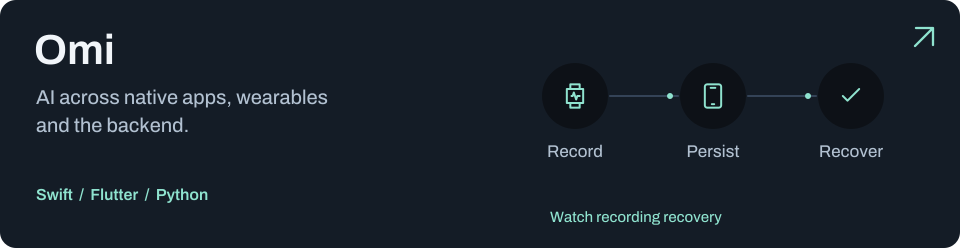
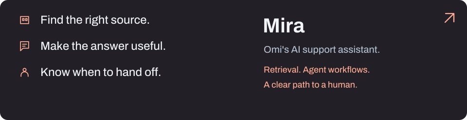
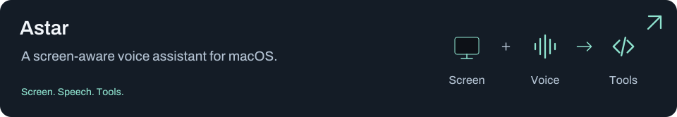
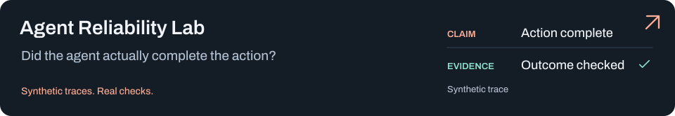
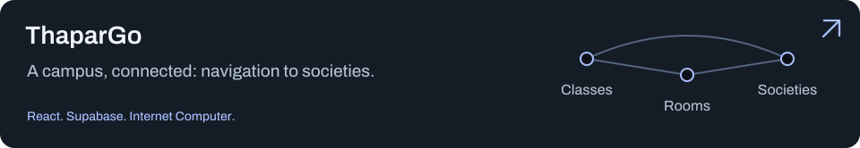
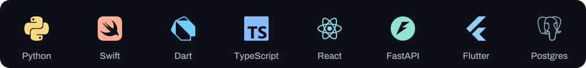
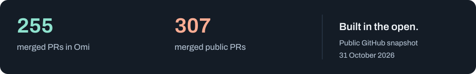

<picture>
  <source media="(max-width: 600px)" srcset="assets/header-mobile.svg">
  
</picture>

  
  
  

I like turning a real user problem into a fix you can inspect. **Thapar '28**, building at **[Omi](https://github.com/BasedHardware/omi)**.

## What I'm building

<a href="https://github.com/BasedHardware/omi">
  <picture>
    <source media="(max-width: 600px)" srcset="assets/work-omi-mobile.svg">
    
  </picture>
</a>

**A few of my contributions:** [Watch recording recovery](https://github.com/BasedHardware/omi/pull/22059) · [Answers grounded in saved transcripts](https://github.com/BasedHardware/omi/pull/23792) · [Duplicate subscription protection](https://github.com/BasedHardware/omi/pull/22552)

<a href="https://github.com/BasedHardware/omi-vector-bot">
  <picture>
    <source media="(max-width: 600px)" srcset="assets/work-mira-mobile.svg">
    
  </picture>
</a>

I also work on **[Mira](https://github.com/BasedHardware/omi-vector-bot)**: helping people find answers from official sources and giving the harder cases a clear path to a human.

## Outside the day job

<a href="https://github.com/aryanorastar/Astar">
<picture>
  <source media="(max-width: 600px)" srcset="assets/project-astar-mobile.svg">
  
</picture>
</a>

<a href="https://github.com/aryanorastar/agent-reliability-lab">
<picture>
  <source media="(max-width: 600px)" srcset="assets/project-lab-mobile.svg">
  
</picture>
</a>

<a href="https://github.com/aryanorastar/ThaparGo-web3">
<picture>
  <source media="(max-width: 600px)" srcset="assets/project-thapar-mobile.svg">
  
</picture>
</a>

The lab is an independent prototype using synthetic data. Explore the repositories for setup, demos and limits.

## My toolkit

<picture>
  <source media="(max-width: 600px)" srcset="assets/tech-mobile.svg">
  
</picture>

## Built in public

<a href="https://github.com/search?q=author%3Aaryanorastar+is%3Apr+is%3Amerged+is%3Apublic&type=pullrequests">
  <picture>
    <source media="(max-width: 600px)" srcset="assets/activity-mobile.svg">
    
  </picture>
</a>

[Browse my Omi contributions](https://github.com/BasedHardware/omi/pulls?q=is%3Apr+is%3Amerged+author%3Aaryanorastar) · [All merged public PRs](https://github.com/search?q=author%3Aaryanorastar+is%3Apr+is%3Amerged+is%3Apublic&type=pullrequests)

A dated snapshot of merged code. Release state and customer outcomes are recorded separately in the linked work.

## Let's build something useful

Working on an AI product? I'd love to hear what you're building. **[Say hello](mailto:aryangupts05@gmail.com).**

If my open-source work has helped you, you can also support it:

  
  

Trying a project, sharing useful feedback, or contributing a fix helps too. [Behind this profile](MAINTENANCE.md).
