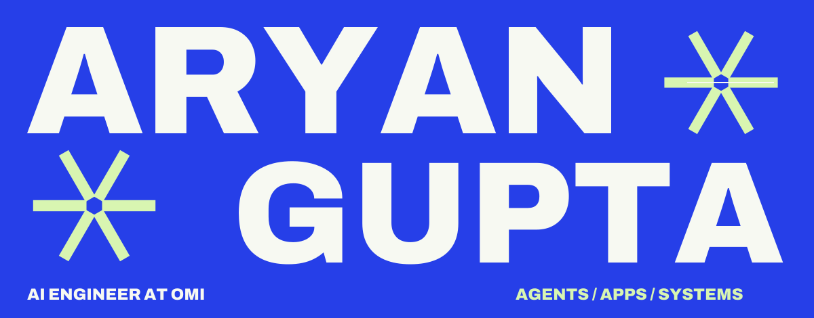

<picture>
  <source media="(prefers-color-scheme: dark) and (max-width: 600px)" srcset="assets/masthead-mobile-dark.svg">
  <source media="(max-width: 600px)" srcset="assets/masthead-mobile.svg">
  <source media="(prefers-color-scheme: dark)" srcset="assets/masthead-dark.svg">
  
</picture>

  <a href="#work-you-can-inspect">Selected work</a> &nbsp; / &nbsp;
  <a href="#built-from-scratch">Personal projects</a> &nbsp; / &nbsp;
  <a href="https://aryanexe.netlify.app">Portfolio</a> &nbsp; / &nbsp;
  <a href="#support-the-work">Support the work</a> &nbsp; / &nbsp;
  <a href="mailto:aryangupts05@gmail.com">Say&nbsp;hello</a>

# I build AI products—and the systems people depend on.

I'm **Aryan**, an AI engineer at **[Omi](https://github.com/BasedHardware/omi)** and a Computer Science student at **Thapar, class of 2028**. I work across agent behavior, native apps and backend reliability: the handoffs, retries and edge cases between a feature and something a person can trust.

My favourite kind of work starts with a real user problem and ends with a change you can inspect.

At Omi, I also work on **[Mira](https://github.com/BasedHardware/omi-vector-bot)**, our AI support assistant: official-source answers, private staff handoffs and reviewed engineering follow-up.

**[255 merged PRs in Omi](https://github.com/BasedHardware/omi/pulls?q=is%3Apr+is%3Amerged+author%3Aaryanorastar)** · **[306 merged public PRs overall](https://github.com/search?q=author%3Aaryanorastar+is%3Apr+is%3Amerged+is%3Apublic&type=pullrequests)**

Public merged-PR snapshot · checked 31 October 2026 · follow either link for the current list.

## Work you can inspect

### A recording should survive the handoff.

**[Watch recording recovery → Omi #22059](https://github.com/BasedHardware/omi/pull/22059)**

Keep original Watch audio until the iPhone has persisted an account-owned copy and acknowledged its digest. Handle late files, restarts and retries through a separate recovery path without restarting the microphone.

Swift · Flutter · Python &nbsp; / &nbsp; durable receipts, account binding, interrupted-write recovery

### An answer should have something behind it.

**[Saved-transcript search and recall evidence → Omi #23792](https://github.com/BasedHardware/omi/pull/23792)**

Search saved speech without requiring a new transcript index. Keep reads bounded, respect corrections and privacy, and withhold unsupported follow-on answers after an explicit transcript search returns no evidence.

Python · retrieval · agent behavior &nbsp; / &nbsp; scoped cursors, deadlines, evidence gates

### A retry should not become a second subscription.

**[Checkout-first subscription protection → Omi #22552](https://github.com/BasedHardware/omi/pull/22552)**

Verify an existing Stripe subscription before allowing fresh checkout—even when the local plan projection is stale. Return a conflict or retryable failure when the existing subscription cannot safely permit another checkout.

Python · FastAPI · Stripe &nbsp; / &nbsp; reconciliation, fail-closed writes, regression tests

<strong>More of the work behind the profile</strong>

- **[Mobile task delivery and safe recovery](https://github.com/BasedHardware/omi/pull/22841)** — canonical task acceptance, durable receipts and stale-response protection across Flutter and the backend.
- **[Offline audio export in background workers](https://github.com/BasedHardware/omi/pull/23497)** — a contributor collaboration with [@ocakciomursel-pixel](https://github.com/ocakciomursel-pixel); shared streaming decode, bounded buffers and atomic export publication.
- **[All merged public changes](https://github.com/search?q=author%3Aaryanorastar+is%3Apr+is%3Amerged+is%3Apublic&type=pullrequests)** — the complete list, with review discussions and verification details.

These are merged engineering contributions. Release state and customer-specific recovery are separate; the linked PRs record their verification and limits.

## Built from scratch

### [Astar ↗](https://github.com/aryanorastar/Astar)

A screen-aware voice assistant for macOS. Local OCR and speech recognition feed a tool-calling workflow for working with apps, developer commands and conversation history.

**Python · Apple Vision · Whisper · MCP** 
[Explore the code](https://github.com/aryanorastar/Astar) · [See the interface](https://github.com/aryanorastar/Astar#what-it-does)

### [Agent Reliability Lab ↗](https://github.com/aryanorastar/agent-reliability-lab)

Small, executable demonstrations of a question I care about: **did the agent actually complete the action it claimed?** Outcome checks, duplicate and late events, and approval-bound retry receipts with a localhost HTTP service and SQLite.

**Python · SQLite · synthetic traces** 
[Run the demos](https://github.com/aryanorastar/agent-reliability-lab#run-in-one-minute) · [Read the limits](https://github.com/aryanorastar/agent-reliability-lab#limits-that-matter)

An independent prototype using synthetic data—not a benchmark or a claim about defects in another company's product.

### [ThaparGo ↗](https://github.com/aryanorastar/ThaparGo-web3)

A campus platform bringing navigation, timetables, room bookings and societies into one place. An earlier project in connecting the interface to the workflow behind it.

**React · Supabase · Internet Computer**

## How I work

**Reproduce → trace the boundary → fix the shared path → verify the failure.**

I like readable code, evidence that survives a retry, and fixes that account for the next caller too. My day-to-day spans **Python / FastAPI**, **Swift**, **Dart / Flutter** and **TypeScript / React**.

If you're building an AI product and need someone who will follow a problem across the stack, I'd like to hear what you're working on.

**[Email me](mailto:aryangupts05@gmail.com)** &nbsp; / &nbsp; **[LinkedIn](https://www.linkedin.com/in/aryangupta45/)** &nbsp; / &nbsp; **[Portfolio](https://aryanexe.netlify.app)**

## Support the work

If something I've built or fixed has been useful to you, you can support my open-source work.

  
  

You can also help by trying a project, reporting a reproducible bug, or contributing a fix.

---

Custom SVGs, native Markdown, public evidence. [How this profile is built](MAINTENANCE.md).
